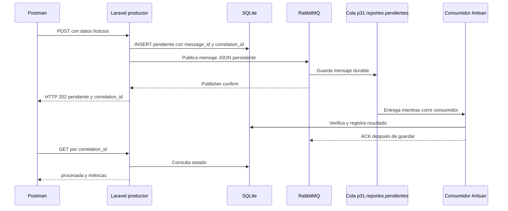

# Flujo de generación de reportes clínicos y financieros

Ante formato inválido del mensaje, el consumidor realiza NACK sin requeue y RabbitMQ
redirige a `p31.reportes.errores` por DLX. La versión síncrona llama directamente al procesador
y responde cuando termina; no pasa por RabbitMQ.
